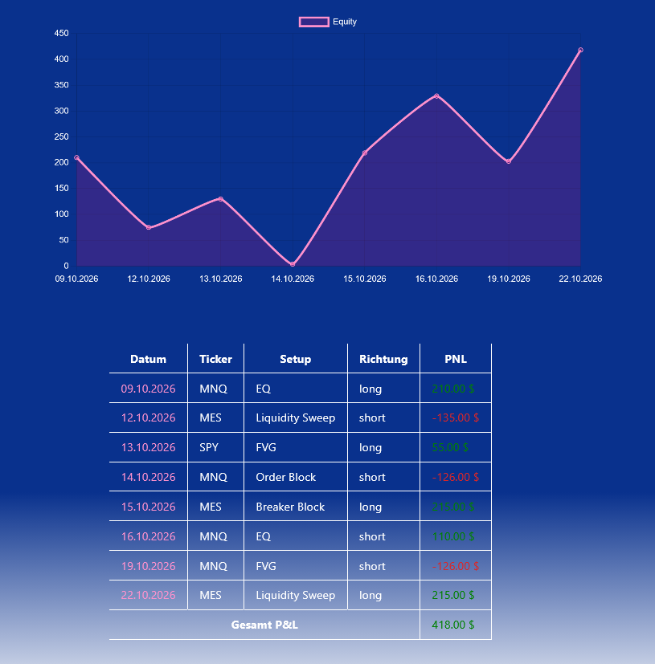

# Trading Dashboard

Ein Web-Dashboard für mein Trading-Journal: Trades erfassen, auswerten und die Entwicklung des Kontos als Equity-Kurve verfolgen – direkt im Browser, ohne Neuladen der Seite.



## Features

- **Trade-Tabelle** mit allen Trades, farblich nach Gewinn/Verlust markiert, und eigener Detailseite pro Trade
- **Kennzahlen:** Gesamt-P&L, Winrate, Anzahl Trades, Gewinner/Verlierer, Ø Gewinn/Verlust, größter Gewinn/Verlust, Profit-Faktor
- **Interaktive Equity-Kurve** (kumulierter P&L), Werte per Hover ablesbar
- **Auswertung pro Setup:** Anzahl, P&L und Winrate je Setup
- **Ticker-Filter:** Tabelle, Kennzahlen, Kurve und Setup-Auswertung zeigen auf Wunsch nur ein Instrument
- **Trades erfassen** über ein Formular – der Server prüft die Eingaben, speichert den Trade, und das Dashboard aktualisiert sich sofort
- **Responsive:** auch auf dem Smartphone nutzbar

## Technik

| Bereich | Eingesetzt |
|---|---|
| Backend | Python, Flask |
| Frontend | HTML, CSS, JavaScript|
| Diagramm | Chart.js |
| Daten | CSV-Datei |

## Aufbau

Das Projekt trennt Daten, Logik und Darstellung:

```
trading-dashboard/
├── app.py              # Flask-Routen: Seiten und JSON-API
├── journal.py          # Laden/Speichern, Berechnungen, Prüfung der Eingaben (ohne Flask)
├── data/
│   └── beispiel_trades.csv
├── templates/          # HTML-Templates (Jinja2)
└── static/
    ├── css/style.css
    └── js/dashboard.js # holt die Daten per fetch und baut Tabelle, Karten und Kurve
```

**Ablauf beim Öffnen des Dashboards:**

1. Der Browser lädt die Seite (`GET /`). Flask liefert ein HTML-Gerüst, dazu CSS und JavaScript.
2. `dashboard.js` fragt die API ab (`/api/trades`, `/api/stats`, `/api/equity`, `/api/setups`). Flask antwortet jeweils mit **JSON**.
3. JavaScript baut daraus im Browser die Tabelle, die Kennzahlen und die Equity-Kurve.
4. Ein neuer Trade wird per `POST /api/trades` als JSON gesendet, vom Server geprüft und gespeichert. Danach lädt das Dashboard die Daten neu – ohne die Seite neu zu laden.

## Installation

Voraussetzung: Python 3.10 oder neuer.

```bash
# 1. Repository klonen
git clone https://github.com/Louiss07/Trading-Dashboard
cd trading-dashboard

# 2. Virtuelle Umgebung anlegen und aktivieren
python -m venv venv
venv\Scripts\activate          # Windows
source venv/bin/activate       # macOS / Linux

# 3. Abhängigkeiten installieren
pip install -r requirements.txt

# 4. Beispieldaten als Arbeitsdatei kopieren
copy data\beispiel_trades.csv data\trades.csv     # Windows
cp data/beispiel_trades.csv data/trades.csv       # macOS / Linux

# 5. Starten
python app.py
```

Danach im Browser `http://127.0.0.1:5000` öffnen.

> `data/trades.csv` steht in der `.gitignore`. Eigene Trades bleiben so lokal und landen nicht im Repository.

## Datenformat

`data/trades.csv` enthält eine Zeile pro Trade:

```
datum,ticker,setup,richtung,pnl
09.10.2026,MNQ,EQ,long,210.0
```

Unterstützte Instrumente und Punktwerte (in `journal.py` festgelegt):

| Ticker | Punktwert |
|---|---|
| MNQ | 2 $ |
| MES | 5 $ |
| SPY | 1 $ pro Aktie |

## API

| Methode | Pfad | Antwort |
|---|---|---|
| GET | `/api/trades` | alle Trades als Liste |
| POST | `/api/trades` | legt einen Trade an (JSON-Body), Antwort `201` oder `400` mit Fehlermeldung |
| GET | `/api/stats` | Kennzahlen |
| GET | `/api/equity` | Datenpunkte der Equity-Kurve |
| GET | `/api/setups` | Auswertung pro Setup |

Alle GET-Endpunkte akzeptieren optional `?ticker=MNQ` (bzw. `MES`, `SPY`). Ein unbekannter Ticker ergibt `400`.

Beispiel für einen neuen Trade:

```json
{
  "datum": "2026-10-09",
  "ticker": "MNQ",
  "setup": "EQ",
  "richtung": "long",
  "stueckzahl": 2,
  "einstieg": 25480.25,
  "ausstieg": 25532.75
}
```

Der P&L wird vom Server aus Einstieg, Ausstieg, Stückzahl und Punktwert berechnet.

## Kennzahlen

- **Winrate** = Gewinner ÷ Anzahl aller Trades × 100
- **Break-even-Trades** (P&L = 0) zählen als Verlierer
- **Profit-Faktor** = Summe aller Gewinne ÷ Betrag der Summe aller Verluste. Ohne Verlusttrade wird kein Wert angezeigt.
- **Equity** = kumulierter P&L nach jedem Trade, in der Reihenfolge der CSV

## Ausblick

- Betrieb auf einem Home-Server, erreichbar im Heimnetz
- Import von Broker-Exporten
